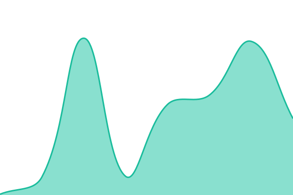

# [📈 Live Status](https://status.stasho.xyz): <!--live status--> **🟩 All systems operational**

Independent status board for [Stasho](https://app.stasho.xyz), the personal cloud powered by Aleph Cloud. It lives on GitHub (Actions + Pages), deliberately off Stasho's own infrastructure, so it stays reachable during the exact outages it reports. Rendered board: [status.stasho.xyz](https://status.stasho.xyz).

## What is monitored

| Signal         | Meaning when red                                                                |
| -------------- | ------------------------------------------------------------------------------- |
| **Stasho App** | The IPFS gateway is not serving the app                                         |
| **Stasho API** | The Stasho backend is unreachable (same probe as the in-app status pill)        |
| **Aleph CCN**  | The Aleph network node is not serving reads; deploys and on-chain reads degrade |

Deployed user sites are pinned on IPFS and keep serving regardless of what this board shows.

Incidents are tracked as [issues](https://github.com/cpascariello/stasho-status/issues) in this repository: one opens automatically when a check goes down and closes on recovery. See the [status guide](https://docs.stasho.xyz/status.html) for what each signal means.

<!--start: status pages-->
<!-- This summary is generated by Upptime (https://github.com/upptime/upptime) -->
<!-- Do not edit this manually, your changes will be overwritten -->
<!-- prettier-ignore -->
| URL | Status | History | Response Time | Uptime |
| --- | ------ | ------- | ------------- | ------ |
|  [Stasho App](https://app.stasho.xyz) | 🟩 Up | [stasho-app.yml](https://github.com/cpascariello/stasho-status/commits/HEAD/history/stasho-app.yml) | 

 1029ms
     
 | 

<a href="https://status.stasho.xyz/history/stasho-app">100.00%</a>
    

|  [Stasho API](https://api.stasho.xyz/api/health) | 🟩 Up | [stasho-api.yml](https://github.com/cpascariello/stasho-status/commits/HEAD/history/stasho-api.yml) | 

 325ms
     
 | 

<a href="https://status.stasho.xyz/history/stasho-api">91.36%</a>
    

|  [Stasho API drop signer](https://api.stasho.xyz/api/health) | 🟩 Up | [stasho-api-drop-signer.yml](https://github.com/cpascariello/stasho-status/commits/HEAD/history/stasho-api-drop-signer.yml) | 

 98ms
     
 | 

<a href="https://status.stasho.xyz/history/stasho-api-drop-signer">91.37%</a>
    

|  [Stasho API backup](https://api.stasho.xyz/api/health) | 🟩 Up | [stasho-api-backup.yml](https://github.com/cpascariello/stasho-status/commits/HEAD/history/stasho-api-backup.yml) | 

 123ms
     
 | 

<a href="https://status.stasho.xyz/history/stasho-api-backup">85.17%</a>
    

|  [Stasho API Solana anchor signer](https://api.stasho.xyz/api/health) | 🟩 Up | [stasho-api-solana-anchor-signer.yml](https://github.com/cpascariello/stasho-status/commits/HEAD/history/stasho-api-solana-anchor-signer.yml) | 

 100ms
     
 | 

<a href="https://status.stasho.xyz/history/stasho-api-solana-anchor-signer">91.39%</a>
    

|  [Stasho API verified frontends signer](https://api.stasho.xyz/api/health) | 🟩 Up | [stasho-api-verified-frontends-signer.yml](https://github.com/cpascariello/stasho-status/commits/HEAD/history/stasho-api-verified-frontends-signer.yml) | 

 101ms
     
 | 

<a href="https://status.stasho.xyz/history/stasho-api-verified-frontends-signer">91.40%</a>
    

|  Verified frontends monitor | 🟩 Up | [verified-frontends-monitor.yml](https://github.com/cpascariello/stasho-status/commits/HEAD/history/verified-frontends-monitor.yml) | 

 93ms
     
 | 

<a href="https://status.stasho.xyz/history/verified-frontends-monitor">100.00%</a>
    

|  [Aleph CCN](https://api.aleph.im/api/v0/info/public.json) | 🟩 Up | [aleph-ccn.yml](https://github.com/cpascariello/stasho-status/commits/HEAD/history/aleph-ccn.yml) | 

 790ms
     
 | 

<a href="https://status.stasho.xyz/history/aleph-ccn">100.00%</a>
    

<!--end: status pages-->

[**Visit our status website →**](https://status.stasho.xyz)

## 📄 License

- Powered by: [Upptime](https://github.com/upptime/upptime)
- Code: [MIT](./LICENSE) © [Anand Chowdhary](https://anandchowdhary.com)
- Data in the `./history` directory: [Open Database License](https://opendatacommons.org/licenses/odbl/1-0/)
